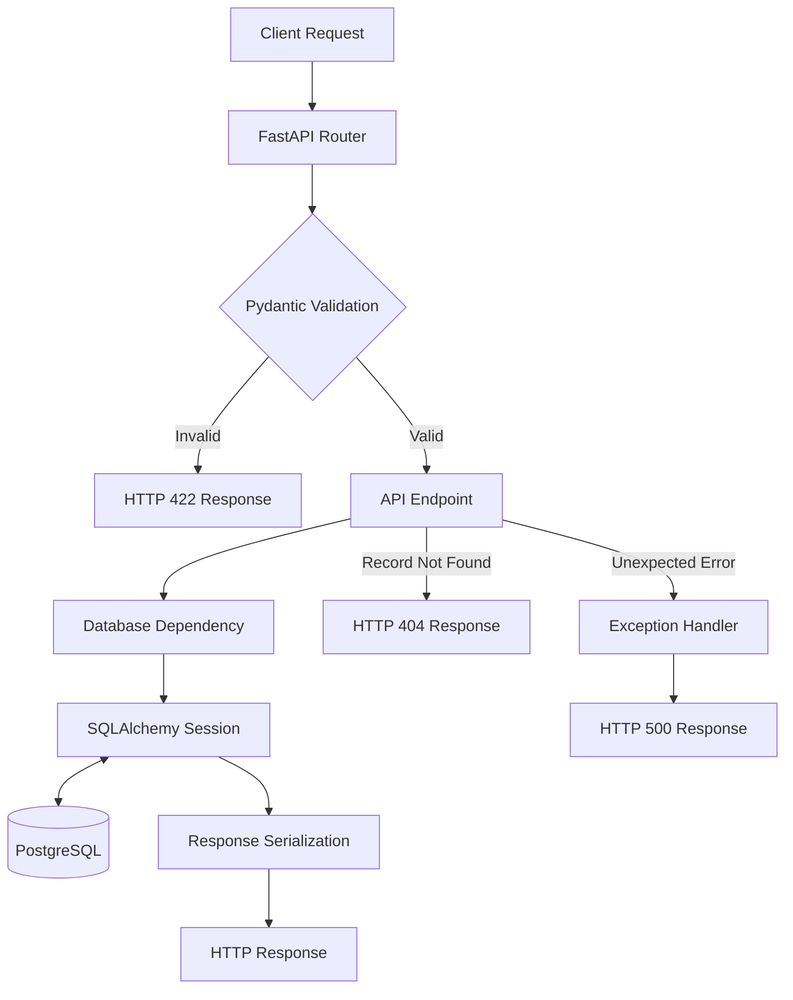

# CareerOS

**A REST API for tracking job applications and organizing the job search.**

CareerOS helps users record job applications, track their status, and manage application details in one place. I built it to solve the problem of tracking applications across companies and roles while strengthening my backend engineering skills through a practical project.

**Tech stack:** Python · FastAPI · PostgreSQL · SQLAlchemy · Pydantic · Alembic

### Current capabilities

- Application CRUD operations
- Request validation and status normalization
- PostgreSQL persistence and database constraints
- Version-controlled database migrations
- Automated API tests

### Project focus

Backend API design, data integrity, validation, testing, and secure authentication.

## Architecture

CareerOS follows a layered architecture that separates request validation, API logic, database access, and persistence.



### Component responsibilities

1. **FastAPI** — Routes HTTP requests to the appropriate endpoint and manages dependency injection.
2. **Pydantic** — Validates request data and applies defined normalization rules.
3. **SQLAlchemy** — Manages ORM models, database sessions, and database operations.
4. **PostgreSQL** — Persists application records and enforces database constraints.
5. **Error handling** — Returns appropriate HTTP responses for invalid input, missing records, and unexpected errors.

### Data persistence

For a create request, the endpoint adds the new application to the SQLAlchemy session, commits the transaction, refreshes the ORM object when needed, and returns the response to the client.

## Database Design and Integrity

CareerOS uses PostgreSQL for persistent storage and SQLAlchemy ORM to map database tables to Python models.

### Applications table

The `applications` table stores job application records.

| Column     | Purpose                                                         |
| ---------- | --------------------------------------------------------------- |
| `id`       | Primary key identifying an application                          |
| `company`  | Company name; required and indexed                              |
| `position` | Job position; required                                          |
| `status`   | Application status; required and restricted to supported values |

### Data integrity

- **NOT NULL constraints** prevent required fields from being stored as `NULL`.
- **Status check constraint** restricts stored statuses to the supported application lifecycle values.
- **Unique indexes on user identity fields** prevent duplicate usernames and email addresses.
- **Alembic migrations** version database schema changes so they can be applied and tracked consistently.

### Schema evolution

Database changes are managed through versioned Alembic migrations rather than relying solely on automatic table creation. This makes schema changes explicit and reviewable.

## Validation and Error Handling

CareerOS validates incoming application data before persisting it to PostgreSQL.

### Request validation

- Required text fields reject empty or whitespace-only values.
- Company and position fields enforce maximum lengths.
- Application statuses are restricted to supported values.
- Status input is normalized before validation, where applicable.

### Error handling

The API returns appropriate HTTP responses for successful operations, invalid requests, missing application records, and unexpected server errors.

Unexpected errors are handled without exposing internal exception details to API clients.

## Testing

CareerOS uses `pytest` and FastAPI's test client to test API behavior.

The existing test suite covers application CRUD operations, request validation, and error handling.

Tests use a dedicated PostgreSQL test database separate from the application database. FastAPI dependency overrides allow tests to control database access.

Run the tests locally:

```bash
pytest -v
```

## Getting Started

### Prerequisites

- Python
- PostgreSQL
- Git

### 1. Clone the repository

```bash
git clone https://github.com/purna9101/CareerOS.git
cd CareerOS
```

### 2. Create and activate a virtual environment

```bash
python -m venv .venv
```

Windows PowerShell:

```powershell
.\.venv\Scripts\Activate.ps1
```

### 3. Install dependencies

```bash
python -m pip install -r requirements.txt
```

### 4. Configure environment variables

Create a `.env` file in the project root and configure `DATABASE_URL` with your local PostgreSQL connection string.

Never commit `.env` or database credentials.

### 5. Apply database migrations

```bash
alembic upgrade head
```

### 6. Start the application

```bash
uvicorn app.main:app --reload
```

Open `http://127.0.0.1:8000/docs` to explore the API using Swagger UI.

## API Examples

### Create an application

`POST /applications`

```json
{
  "company": "Example Technologies",
  "position": "Python Backend Developer",
  "status": "applied"
}
```

### List applications

`GET /applications`

The API supports filtering applications by company, position, and status.

### Retrieve an application

`GET /applications/{application_id}`

### Update an application

`PATCH /applications/{application_id}`

### Delete an application

`DELETE /applications/{application_id}`

See the interactive Swagger documentation at `/docs` for request schemas and response details.
